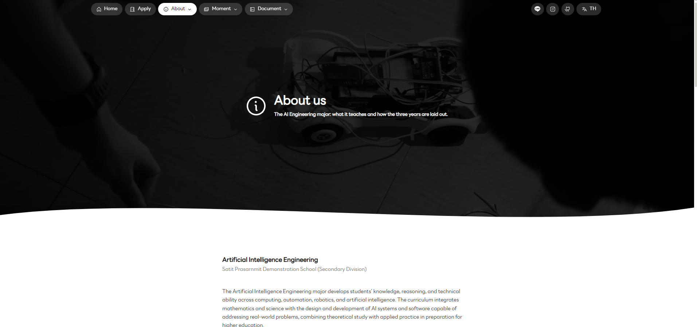

# My UI Skill

Three written UI identities (CI) and a Claude Code skill that applies them. Each CI is a full
written spec — colour tokens, type scale, spacing, component-by-component rules, do/don't lists —
not a vibe. Point the skill at one and it builds pages that match the existing site instead of
inventing a new look.

| Style | Use for | Live example |
|---|---|---|
| CI-1 Curve Bold | Personal and multi-page org sites: white paper, black ink, one weight, 10px curves, grouped pill nav | [eaispsm.vercel.app](https://eaispsm.vercel.app/) |
| CI-2 Thin | Sites with colour: every page is white plus one page colour, separate outlined cards | — |
| CI-3 Thin Box | App interfaces: square boxes, sidebar shell, tokens, Next.js and Tailwind | [eduhub-cy2v.vercel.app](https://eduhub-cy2v.vercel.app/) |

## Layout

- `docs/` the three guides, readable on their own, plus `docs/images/` screenshots of the live sites
- `skills/ci-ui/` the Claude Code skill — `SKILL.md`, a `references/` copy of each guide, and
  `references/fonts/` with the self-hosted LINE Seed Sans TH font used by CI-1
- `NOTICE.md` ownership and usage terms

## Install the skill

Copy `skills/ci-ui` into `~/.claude/skills/` (all projects) or `.claude/skills/` (one project). Start a new session and ask for a page in "my CI". If you don't name a style, the skill asks which one (or uses the existing site's style when you're adding a page).

## Shared rules (all three styles)

Written once in [`skills/ci-ui/SKILL.md`](skills/ci-ui/SKILL.md) so the three guides don't repeat them:

- **Language.** Thai and English by default, `data-th` on every text node, a TH/EN nav button, choice saved in `localStorage`.
- **Page blink.** A quick white dip between pages via cross-document view transitions, with a plain fade fallback for browsers without support.
- **Reduced motion** respected everywhere motion is used.
- **No hover tooltips** — `aria-label` on icon-only controls, never `title`.
- **No phone tap highlight**, external links open in a new tab with `rel="noopener"`.
- **Hover is brightness-only** — a lighter or darker shade of the same colour, never a hue swap or a surprise accent.
- **Nav adapts to its background** — translucent over a photo hero, normal surface colours once scrolled past it or on a page with no hero.
- **No native browser chrome** — dropdowns, date pickers, menus and popovers are hand-built to match the style's tokens, never a bare `<select>` or native `<input type="date">`.
- **Dropdowns animate open/close** — height/opacity transition, cut to instant under reduced motion.
- **Search fields use an underline**, not a bordered box.
- **Optional photo hero** — any style can use one: full-bleed photo, flat 78% black overlay, white left-aligned text, white wave along the bottom edge, nav as translucent pills over it.

## CI-1 Curve Bold — in practice

Live at **[eaispsm.vercel.app](https://eaispsm.vercel.app/)**: a school major landing page. White paper, black ink, one typeface, soft 10px curves, pill-shaped grouped nav top-right, dark photo hero with a bold headline, a row of icon link pills underneath, and a grid of rounded link cards ("Apply", "About the major", "Accomplishment", ...) below the fold.

| Home | Interior page hero |
|---|---|
|  |  |

The second screenshot is the optional photo hero on an interior page: dark overlay photo, white icon-plus-title pair centred in the frame, nav pills still visible on top, white wave cutting into the body below.

Component inventory worth knowing about (full detail in the guide): pill nav with hover-open dropdown groups, icon-row items, poster/photo-cover card grids, a justified photo gallery that packs images edge-to-edge by aspect ratio, a hairline FAQ accordion, plain-text filter tabs that wrap instead of scroll, a centred 404 page, and a waffle-style unit chart with a linked legend for small counted breakdowns.

Read the full spec in [`docs/CI-1-Curve-Bold.md`](docs/CI-1-Curve-Bold.md).

## CI-2 Thin — in practice

No live deployment linked yet. Every page is white plus one page colour, cards are separate and outlined rather than grouped into a grey section, tags and tabs are plain underlined text with no pill backgrounds. Read the full spec in [`docs/CI-2-Thin.md`](docs/CI-2-Thin.md).

## CI-3 Thin Box — in practice

Live at **[eduhub-cy2v.vercel.app](https://eduhub-cy2v.vercel.app/)** (Edu_Hub): an app-style product. Square boxes, hairline borders, token-driven colour, left sidebar shell with sections (Chat, Notes, Flashcards, Exam Bank, Progress), and a pricing page with square outlined plan cards.

| Marketing hero (dark) | Pricing page (light) | App shell (dark) |
|---|---|---|
|  |  |  |

CI-3 runs both a light marketing surface and a dark app surface off the same token system — only the token values swap, not the components. The marketing pages use square outlined buttons and card-row feature grids; the app shell is a persistent left sidebar plus a centred chat/content column.

Read the full spec in [`docs/CI-3-Thin-Box.md`](docs/CI-3-Thin-Box.md).

## Font

CI-1 uses one self-hosted typeface, LINE Seed Sans TH, Regular weight only (bold text is faux-bold,
never a second font file). The `.woff2` and its own license notes are vendored at
[`skills/ci-ui/references/fonts/`](skills/ci-ui/references/fonts/).

## Reference websites

Sites used as visual references for these styles:

- Chulalongkorn University: https://www.chula.ac.th/en/
- Anthropic: https://www.anthropic.com/
- Claude: https://claude.com/
- Fastwork: https://fastwork.com/
- 1DD: https://1dd.co/

## Ownership

This repository belongs to Raphee Rattanamanoonporn. See [`NOTICE.md`](NOTICE.md) for usage terms.
