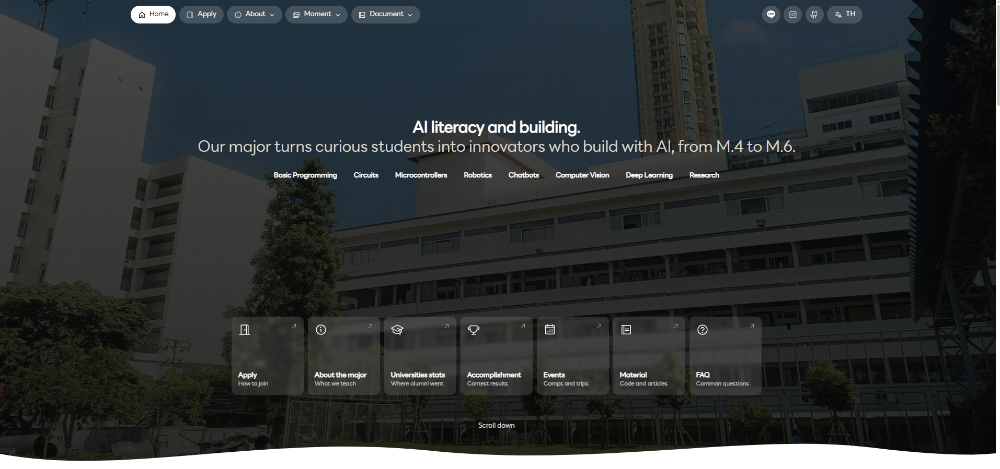
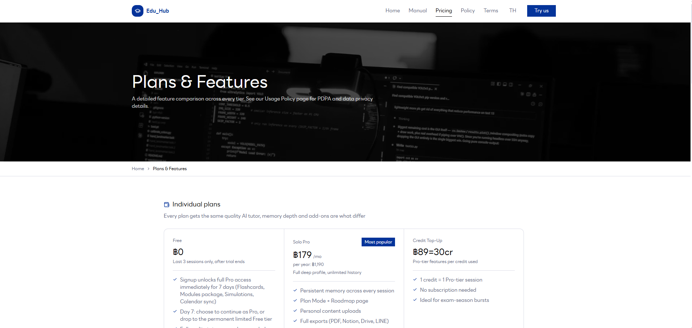
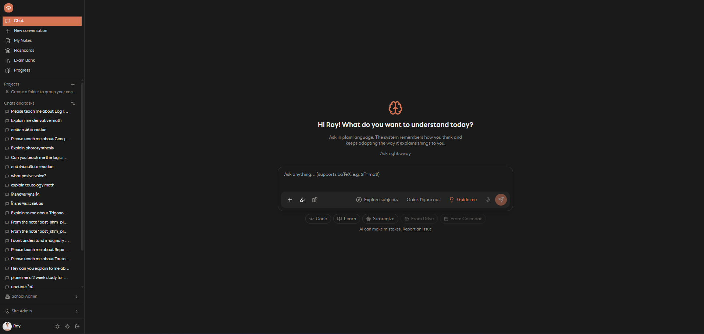

# My UI Skill

Three written UI identities (CI) and a Claude Code skill that applies them.

| Style | Use for | Live example |
|---|---|---|
| CI-1 Curve Bold | Personal and multi-page org sites: white paper, black ink, one weight, 10px curves, grouped pill nav | [eaispsm.vercel.app](https://eaispsm.vercel.app/) |
| CI-2 Thin | Sites with colour: every page is white plus one page colour, separate outlined cards | — |
| CI-3 Thin Box | App interfaces: square boxes, sidebar shell, tokens, Next.js and Tailwind | [eduhub-cy2v.vercel.app](https://eduhub-cy2v.vercel.app/) |

## Layout

- `docs/` the three guides, readable on their own, plus `docs/images/` screenshots of the live sites
- `skills/ci-ui/` the Claude Code skill (`SKILL.md` plus a `references/` copy of each guide)

## Install the skill

Copy `skills/ci-ui` into `~/.claude/skills/` (all projects) or `.claude/skills/` (one project). Start a new session and ask for a page in "my CI".

## Shared rules

Thai and English toggle, page blink between pages, no hover tooltips, no phone tap highlight, reduced motion respected, and an optional photo hero. They are written once in `skills/ci-ui/SKILL.md`.

## CI-1 Curve Bold — in practice

Live at **[eaispsm.vercel.app](https://eaispsm.vercel.app/)**: a school major landing page. White paper, black ink, one typeface, soft 10px curves, pill-shaped grouped nav top-right, dark photo hero with a bold headline, a row of icon link pills underneath, and a grid of rounded link cards ("Apply", "About the major", "Accomplishment", ...) below the fold.

Read the full spec in [`docs/CI-1-Curve-Bold.md`](docs/CI-1-Curve-Bold.md).

## CI-3 Thin Box — in practice

Live at **[eduhub-cy2v.vercel.app](https://eduhub-cy2v.vercel.app/)** (Edu_Hub): an app-style product. Square boxes, hairline borders, token-driven colour, left sidebar shell with sections (Chat, Notes, Flashcards, Exam Bank, Progress), and a pricing page with square outlined plan cards.

| Marketing page (light) | App shell (dark) |
|---|---|
|  |  |

Note CI-3 supports both a light marketing surface and a dark app surface from the same token system — only the token values swap. Read the full spec in [`docs/CI-3-Thin-Box.md`](docs/CI-3-Thin-Box.md).

## Reference websites

Sites used as visual references for these styles:

- Chulalongkorn University: https://www.chula.ac.th/en/
- Anthropic: https://www.anthropic.com/
- Claude: https://claude.com/
- Fastwork: https://fastwork.com/
- 1DD: https://1dd.co/
